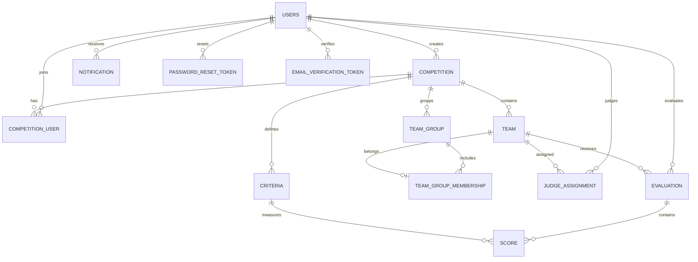

# ฐานข้อมูลและความสัมพันธ์

[กลับสารบัญ](README.md)

## ขอบเขต schema

อ้างอิง JPA Entity ของ source ปัจจุบัน ไม่ใช่ผล `SHOW CREATE TABLE` ของ Aiven จึงแสดง Java type และ annotation จริง ไม่เดาว่า UUID ที่ฐานจริงเป็น CHAR/BINARY แบบใด ชื่อคอลัมน์ที่ไม่ได้ระบุ @Column/@JoinColumn โดยตรงแสดงรูป snake_case ที่คาดจาก naming strategy ของ Spring Boot ต้องตรวจ DDL จริงก่อน migration

มี Entity 18 ตาราง และ composite-key class อีก 2 ไฟล์ Source ไม่มี Entity/Repository/Controller สำหรับ `judge_coi` หรือ `team_members` ตารางที่ค้างในฐานเก่าไม่ใช่หลักฐานว่ายังใช้งาน ไม่ควร DROP จากรายงานนี้โดยไม่ตรวจ schema/backup เพิ่ม

## ภาพความสัมพันธ์หลัก



ภาพนี้แสดงความสัมพันธ์เชิงธุรกิจหลัก ไม่ได้ใส่ทุก FK ในรูป Audit/outbox บางส่วนเก็บ UUID ธรรมดาและ snapshot จึงไม่ควรตีความเป็น FK ที่ฐานบังคับครบทุกเส้น

## `Competition.java` → `competition`

[backend/src/main/java/org/cesystem/multirole/model/Competition.java](../../backend/src/main/java/org/cesystem/multirole/model/Competition.java)

โครงการ/การแข่งขันหนึ่งรายการ มีผู้สร้าง สถานะกำหนดส่ง และ flag ล็อกถาวรหลังเปิดรับคะแนน

| Field | Java type | Column/ความสัมพันธ์ | หน้าที่ | JPA metadata |
| --- | --- | --- | --- | --- |
| `competitionId` | UUID | competition_id | UUID ของโครงการที่เกี่ยวข้อง | @Id @GeneratedValue(strategy = GenerationType.UUID) |
| `createdBy` | User | created_by | ความสัมพันธ์ผู้สร้างโครงการไป User | @ManyToOne(fetch = FetchType.LAZY, optional = false) @JoinColumn(name = "created_by", nullable = false) |
| `title` | String | title | ชื่อโครงการ/เกณฑ์/หัวข้อแจ้งเตือนตามตาราง | @Column(nullable = false, unique = true, length = 200) |
| `description` | String | description | รายละเอียดโครงการหรือ rubric เกณฑ์ | @Column(columnDefinition = "TEXT") |
| `category` | String | category | หมวดหมู่โครงการ | @Column(length = 20) |
| `status` | String | status | สถานะของ Entity นี้ ดูคำอธิบายสถานะด้านล่าง | @Column(nullable = false, length = 20) |
| `createdAt` | LocalDateTime | created_at | เวลาสร้างรายการ | @CreationTimestamp @Column(nullable = false, updatable = false) |
| `evaluationDeadline` | LocalDateTime | evaluation_deadline | กำหนดปิดรับ/แก้ไขคะแนน | — |
| `closedAt` | LocalDateTime | closed_at | เวลาที่เปลี่ยนสถานะโครงการเป็น CLOSED | — |
| `criteriaLocked` | Boolean | criteria_locked | flag ล็อกเกณฑ์และโครงสร้าง แม้กลับไป DRAFT จะไม่ปลดล็อก | — |

Accessor: `@Getter/@Setter` สร้าง getter/setter ของ fields; composite key ใช้ Lombok equals/hashCode ตาม annotation; ไม่มี custom business method ใน model นี้

## `CompetitionUser.java` → `competition_user`

[backend/src/main/java/org/cesystem/multirole/model/CompetitionUser.java](../../backend/src/main/java/org/cesystem/multirole/model/CompetitionUser.java)

สมาชิกต่อโครงการ ใช้ composite key (competition,user) และ role ระดับโครงการ

| Field | Java type | Column/ความสัมพันธ์ | หน้าที่ | JPA metadata |
| --- | --- | --- | --- | --- |
| `competition` | Competition | competition_id | ความสัมพันธ์ไป Competition หรือส่วนของ composite key | @Id @ManyToOne(fetch = FetchType.LAZY) @JoinColumn(name = "competition_id", nullable = false) @OnDelete(action = OnDeleteAction.CASCADE) |
| `user` | User | user_id | ความสัมพันธ์ไป User หรือส่วนของ composite key | @Id @ManyToOne(fetch = FetchType.LAZY) @JoinColumn(name = "user_id", nullable = false) |
| `role` | String | role | บทบาทสมาชิก ADMIN, JUDGE หรือ ADMIN_JUDGE | @Column(nullable = false, length = 20) |

Accessor: `@Getter/@Setter` สร้าง getter/setter ของ fields; composite key ใช้ Lombok equals/hashCode ตาม annotation; ไม่มี custom business method ใน model นี้

## `CompetitionUserId.java` — Composite key

[backend/src/main/java/org/cesystem/multirole/model/CompetitionUserId.java](../../backend/src/main/java/org/cesystem/multirole/model/CompetitionUserId.java)

ชนิด composite key สำหรับ CompetitionUser ไม่ใช่ตารางเพิ่ม มี equals/hashCode จาก Lombok

| Field | Java type | Column/ความสัมพันธ์ | หน้าที่ | JPA metadata |
| --- | --- | --- | --- | --- |
| `competition` | UUID | ส่วน key: competition | ความสัมพันธ์ไป Competition หรือส่วนของ composite key | — |
| `user` | UUID | ส่วน key: user | ความสัมพันธ์ไป User หรือส่วนของ composite key | — |

Accessor: `@Getter/@Setter` สร้าง getter/setter ของ fields; composite key ใช้ Lombok equals/hashCode ตาม annotation; ไม่มี custom business method ใน model นี้

## `Criteria.java` → `criteria`

[backend/src/main/java/org/cesystem/multirole/model/Criteria.java](../../backend/src/main/java/org/cesystem/multirole/model/Criteria.java)

เกณฑ์หนึ่งหัวข้อของการแข่งขัน มีรูปแบบ คะแนนเต็ม น้ำหนัก และ description ที่บรรจุ rubric

| Field | Java type | Column/ความสัมพันธ์ | หน้าที่ | JPA metadata |
| --- | --- | --- | --- | --- |
| `criterionId` | UUID | criterion_id | UUID ของเกณฑ์ | @Id @GeneratedValue(strategy = GenerationType.UUID) |
| `competition` | Competition | competition_id | ความสัมพันธ์ไป Competition หรือส่วนของ composite key | @ManyToOne(fetch = FetchType.LAZY, optional = false) @JoinColumn(name = "competition_id", nullable = false) @OnDelete(action = OnDeleteAction.CASCADE) |
| `title` | String | title | ชื่อโครงการ/เกณฑ์/หัวข้อแจ้งเตือนตามตาราง | @Column(nullable = false, length = 200) |
| `description` | String | description | รายละเอียดโครงการหรือ rubric เกณฑ์ | @Column(columnDefinition = "TEXT") |
| `scoringType` | String | scoring_type | ชนิด STAR, NUMERIC, PERCENTAGE หรือ PASS_FAIL | @Column(nullable = false, length = 20) |
| `maxScore` | BigDecimal | max_score | คะแนนเต็มรายเกณฑ์ | @Column(nullable = false, precision = 6, scale = 2) |
| `weightPercentage` | BigDecimal | weight_percentage | เปอร์เซ็นต์น้ำหนักรายเกณฑ์ | @Column(nullable = false, precision = 5, scale = 2) |

Accessor: `@Getter/@Setter` สร้าง getter/setter ของ fields; composite key ใช้ Lombok equals/hashCode ตาม annotation; ไม่มี custom business method ใน model นี้

## `DeadlineHistory.java` → `deadline_history`

[backend/src/main/java/org/cesystem/multirole/model/DeadlineHistory.java](../../backend/src/main/java/org/cesystem/multirole/model/DeadlineHistory.java)

ประวัติเปลี่ยนกำหนดส่ง เก็บผู้เปลี่ยนแบบ snapshot และเวลาเดิม/ใหม่

| Field | Java type | Column/ความสัมพันธ์ | หน้าที่ | JPA metadata |
| --- | --- | --- | --- | --- |
| `id` | UUID | id | UUID หลักของแถว | @Id @GeneratedValue(strategy = GenerationType.UUID) |
| `competition` | Competition | competition_id | ความสัมพันธ์ไป Competition หรือส่วนของ composite key | @ManyToOne(fetch = FetchType.LAZY, optional = false) @JoinColumn(name = "competition_id", nullable = false) @OnDelete(action = OnDeleteAction.CASCADE) |
| `actorId` | UUID | actor_id | UUID ผู้ดำเนินการที่เก็บในประวัติ | @Column(nullable = false) |
| `actorName` | String | actor_name | ชื่อผู้ดำเนินการแบบ snapshot | @Column(nullable = false, length = 150) |
| `actorEmail` | String | actor_email | อีเมลผู้ดำเนินการแบบ snapshot | @Column(nullable = false, length = 255) |
| `previousDeadline` | LocalDateTime | previous_deadline | กำหนดส่งเดิม อาจไม่มีค่า | — |
| `newDeadline` | LocalDateTime | new_deadline | กำหนดส่งใหม่ อาจไม่มีค่า | — |
| `changedAt` | LocalDateTime | changed_at | เวลาเปลี่ยน deadline | @Column(nullable = false) |

Constraint/index ระดับตารางตาม source:

```java
@Table(name = "deadline_history", indexes = @Index(name = "idx_deadline_comp_time", columnList = "competition_id,changedAt"))
```

Accessor: `@Getter/@Setter` สร้าง getter/setter ของ fields; composite key ใช้ Lombok equals/hashCode ตาม annotation; ไม่มี custom business method ใน model นี้

## `EmailOutbox.java` → `email_outbox`

[backend/src/main/java/org/cesystem/multirole/model/EmailOutbox.java](../../backend/src/main/java/org/cesystem/multirole/model/EmailOutbox.java)

คิวอีเมลที่อยู่ในฐาน เก็บ encrypted payload สถานะ due/retry และใบรับ messageId จาก Brevo

| Field | Java type | Column/ความสัมพันธ์ | หน้าที่ | JPA metadata |
| --- | --- | --- | --- | --- |
| `id` | UUID | id | UUID หลักของแถว | @Id @GeneratedValue(strategy = GenerationType.UUID) |
| `userId` | UUID | user_id | UUID ของบัญชีที่เกี่ยวข้อง | @Column(nullable = false) |
| `competitionId` | UUID | competition_id | UUID ของโครงการที่เกี่ยวข้อง | — |
| `notificationId` | UUID | notification_id | UUID ของแจ้งเตือนที่เกี่ยวข้อง | — |
| `tokenId` | UUID | token_id | UUID ของ verification/reset token ที่เกี่ยวข้อง | — |
| `recipient` | String | recipient | อีเมลผู้รับของ outbox | @Column(nullable = false) |
| `purpose` | String | purpose | ประเภทอีเมล VERIFY_EMAIL, RESET_PASSWORD หรือ REMINDER | @Column(nullable = false, length = 30) |
| `encryptedPayload` | String | encrypted_payload | JSON subject/html ที่เข้ารหัส AES-GCM; ล้างเมื่อจบการส่งหรือยกเลิก | @Column(columnDefinition = "LONGTEXT") |
| `status` | String | status | สถานะของ Entity นี้ ดูคำอธิบายสถานะด้านล่าง | @Column(nullable = false, length = 20) |
| `attempts` | int | attempts | จำนวนครั้งที่ลองส่งอีเมล | — |
| `createdAt` | LocalDateTime | created_at | เวลาสร้างรายการ | @Column(nullable = false) |
| `nextAttemptAt` | LocalDateTime | next_attempt_at | เวลาที่ส่ง/ลองใหม่ได้ | @Column(nullable = false) |
| `expiresAt` | LocalDateTime | expires_at | เวลาหมดอายุ token หรือความเกี่ยวข้องของอีเมล | — |
| `acceptedAt` | LocalDateTime | accepted_at | เวลาที่ Brevo ตอบรับคำขอ ไม่ยืนยันการเข้ากล่องผู้รับ | — |
| `providerMessageId` | String | provider_message_id | messageId ที่ Brevo ส่งกลับ | — |
| `lastError` | String | last_error | รหัสผิดพลาดที่เก็บสำหรับการส่งอีเมล ไม่เก็บ secret | @Column(length = 80) |

Constraint/index ระดับตารางตาม source:

```java
@Table(name = "email_outbox", indexes = @Index(name = "idx_mail_due", columnList = "status,nextAttemptAt"))
```

Accessor: `@Getter/@Setter` สร้าง getter/setter ของ fields; composite key ใช้ Lombok equals/hashCode ตาม annotation; ไม่มี custom business method ใน model นี้

## `EmailVerificationToken.java` → `email_verification_token`

[backend/src/main/java/org/cesystem/multirole/model/EmailVerificationToken.java](../../backend/src/main/java/org/cesystem/multirole/model/EmailVerificationToken.java)

token ยืนยันบัญชีแบบ hash อายุหนึ่งชั่วโมง ใช้ครั้งเดียว

| Field | Java type | Column/ความสัมพันธ์ | หน้าที่ | JPA metadata |
| --- | --- | --- | --- | --- |
| `id` | UUID | id | UUID หลักของแถว | @Id @GeneratedValue(strategy = GenerationType.UUID) |
| `user` | User | user_id | ความสัมพันธ์ไป User หรือส่วนของ composite key | @ManyToOne(fetch = FetchType.LAZY, optional = false) @JoinColumn(name = "user_id", nullable = false) @OnDelete(action = OnDeleteAction.CASCADE) |
| `tokenHash` | String | token_hash | SHA-256 hash ของ raw token แทนการเก็บ token ตรงในตารางนี้ | @Column(nullable = false, unique = true, length = 64) |
| `createdAt` | LocalDateTime | created_at | เวลาสร้างรายการ | @Column(nullable = false) |
| `expiresAt` | LocalDateTime | expires_at | เวลาหมดอายุ token หรือความเกี่ยวข้องของอีเมล | @Column(nullable = false) |
| `usedAt` | LocalDateTime | used_at | เวลาที่ใช้หรือ invalidate token แล้ว | — |

Accessor: `@Getter/@Setter` สร้าง getter/setter ของ fields; composite key ใช้ Lombok equals/hashCode ตาม annotation; ไม่มี custom business method ใน model นี้

## `Evaluation.java` → `evaluation`

[backend/src/main/java/org/cesystem/multirole/model/Evaluation.java](../../backend/src/main/java/org/cesystem/multirole/model/Evaluation.java)

ใบประเมินของกรรมการต่อทีมหนึ่งใบ รวมสถานะ คะแนนรวม ความคิดเห็นและเวลาส่ง

| Field | Java type | Column/ความสัมพันธ์ | หน้าที่ | JPA metadata |
| --- | --- | --- | --- | --- |
| `evaluationId` | UUID | evaluation_id | UUID ของใบประเมิน | @Id @GeneratedValue(strategy = GenerationType.UUID) |
| `competition` | Competition | competition_id | ความสัมพันธ์ไป Competition หรือส่วนของ composite key | @ManyToOne(fetch = FetchType.LAZY, optional = false) @JoinColumn(name = "competition_id", nullable = false) @OnDelete(action = OnDeleteAction.CASCADE) |
| `judge` | User | judge_id | ความสัมพันธ์ผู้ให้คะแนน/กรรมการไป User | @ManyToOne(fetch = FetchType.LAZY, optional = false) @JoinColumn(name = "judge_id", nullable = false) |
| `team` | Team | team_id | ความสัมพันธ์ไป Team หรือส่วนของ composite key | @ManyToOne(fetch = FetchType.LAZY, optional = false) @JoinColumn(name = "team_id", nullable = false) @OnDelete(action = OnDeleteAction.CASCADE) |
| `totalScore` | BigDecimal | total_score | คะแนนถ่วงน้ำหนัก 0–100 ที่ Backend คำนวณ | @Column(precision = 5, scale = 2) |
| `comment` | String | comment | ความคิดเห็นรวมใบประเมิน หรือความคิดเห็นรายเกณฑ์ใน Score | @Column(columnDefinition = "TEXT") |
| `status` | String | status | สถานะของ Entity นี้ ดูคำอธิบายสถานะด้านล่าง | @Column(nullable = false, length = 20) |
| `updatedAt` | LocalDateTime | updated_at | เวลาแก้ไขรายการล่าสุด | @UpdateTimestamp @Column(nullable = false) |
| `submittedAt` | LocalDateTime | submitted_at | เวลาส่งใบประเมิน ล่าสุดเมื่อแก้ใบ SUBMITTED | — |
| `scores` | List<Score> | collection ไม่ใช่ column | collection ของ Score ไม่ใช่คอลัมน์ JSON; cascade/orphanRemoval ตาม JPA | @OneToMany(mappedBy = "evaluation", cascade = CascadeType.ALL, orphanRemoval = true) |

Constraint/index ระดับตารางตาม source:

```java
@Table(
        name = "evaluation",
        uniqueConstraints = @UniqueConstraint(
                name = "uq_evaluation_judge_team",
                columnNames = {"judge_id", "team_id"}))
```

Accessor: `@Getter/@Setter` สร้าง getter/setter ของ fields; composite key ใช้ Lombok equals/hashCode ตาม annotation; ไม่มี custom business method ใน model นี้

## `EvaluationHistory.java` → `evaluation_history`

[backend/src/main/java/org/cesystem/multirole/model/EvaluationHistory.java](../../backend/src/main/java/org/cesystem/multirole/model/EvaluationHistory.java)

ประวัติ snapshot ก่อน/หลังของใบประเมิน เก็บชื่อผู้แก้/ชื่อทีมในขณะนั้นและ JSON ของคะแนน

| Field | Java type | Column/ความสัมพันธ์ | หน้าที่ | JPA metadata |
| --- | --- | --- | --- | --- |
| `historyId` | UUID | history_id | UUID ของประวัติ | @Id @GeneratedValue(strategy = GenerationType.UUID) |
| `evaluationId` | UUID | evaluation_id | UUID ของใบประเมิน | @Column(nullable = false, updatable = false) |
| `competitionId` | UUID | competition_id | UUID ของโครงการที่เกี่ยวข้อง | @Column(nullable = false, updatable = false) |
| `teamId` | UUID | team_id | UUID ของทีมที่เกี่ยวข้อง | @Column(nullable = false, updatable = false) |
| `actorId` | UUID | actor_id | UUID ผู้ดำเนินการที่เก็บในประวัติ | @Column(nullable = false, updatable = false) |
| `actorName` | String | actor_name | ชื่อผู้ดำเนินการแบบ snapshot | @Column(nullable = false, updatable = false) |
| `actorEmail` | String | actor_email | อีเมลผู้ดำเนินการแบบ snapshot | @Column(nullable = false, updatable = false) |
| `teamName` | String | team_name | ชื่อทีม หรือ snapshot ชื่อทีมในประวัติ | @Column(nullable = false, updatable = false) |
| `eventType` | String | event_type | DRAFT_SAVED, SUBMITTED หรือ UPDATED ของประวัติคะแนน | @Column(nullable = false, updatable = false, length = 30) |
| `occurredAt` | LocalDateTime | occurred_at | เวลาเกิดเหตุการณ์ | @Column(nullable = false, updatable = false) |
| `beforeSnapshot` | String | before_snapshot | JSON คะแนน/สถานะก่อนแก้ nullable เมื่อยังไม่มีใบหรือซ่อน draft ใน response | @Column(columnDefinition = "LONGTEXT", updatable = false) |
| `afterSnapshot` | String | after_snapshot | JSON คะแนน/สถานะหลังแก้ | @Column(nullable = false, columnDefinition = "LONGTEXT", updatable = false) |

Constraint/index ระดับตารางตาม source:

```java
@Table(name = "evaluation_history", indexes = @Index(name = "idx_history_evaluation", columnList = "evaluationId,occurredAt"))
```

Accessor: `@Getter/@Setter` สร้าง getter/setter ของ fields; composite key ใช้ Lombok equals/hashCode ตาม annotation; ไม่มี custom business method ใน model นี้

## `EvaluationReminder.java` → `evaluation_reminder`

[backend/src/main/java/org/cesystem/multirole/model/EvaluationReminder.java](../../backend/src/main/java/org/cesystem/multirole/model/EvaluationReminder.java)

บันทึกการเตือนเพื่อ dedupe และ cooldown แยก manual/automatic

| Field | Java type | Column/ความสัมพันธ์ | หน้าที่ | JPA metadata |
| --- | --- | --- | --- | --- |
| `id` | UUID | id | UUID หลักของแถว | @Id @GeneratedValue(strategy = GenerationType.UUID) |
| `competitionId` | UUID | competition_id | UUID ของโครงการที่เกี่ยวข้อง | @Column(nullable = false) |
| `userId` | UUID | user_id | UUID ของบัญชีที่เกี่ยวข้อง | @Column(nullable = false) |
| `dedupeKey` | String | dedupe_key | key unique ป้องกันสร้าง reminder ซ้ำ | @Column(nullable = false, unique = true) |
| `kind` | String | kind | ชนิด MANUAL/AUTO ของ reminder | @Column(nullable = false) |
| `createdAt` | LocalDateTime | created_at | เวลาสร้างรายการ | @Column(nullable = false) |

Constraint/index ระดับตารางตาม source:

```java
@Table(name = "evaluation_reminder", indexes = @Index(name = "idx_reminder_recipient", columnList = "competitionId,userId,createdAt"))
```

Accessor: `@Getter/@Setter` สร้าง getter/setter ของ fields; composite key ใช้ Lombok equals/hashCode ตาม annotation; ไม่มี custom business method ใน model นี้

## `JudgeAssignment.java` → `judge_assignment`

[backend/src/main/java/org/cesystem/multirole/model/JudgeAssignment.java](../../backend/src/main/java/org/cesystem/multirole/model/JudgeAssignment.java)

คู่กรรมการ-ทีมที่ได้รับมอบหมายภายในโครงการ เป็นเงื่อนไขก่อนอนุญาตเขียนคะแนน

| Field | Java type | Column/ความสัมพันธ์ | หน้าที่ | JPA metadata |
| --- | --- | --- | --- | --- |
| `assignmentId` | UUID | assignment_id | UUID ของการมอบหมาย | @Id @GeneratedValue(strategy = GenerationType.UUID) |
| `competition` | Competition | competition_id | ความสัมพันธ์ไป Competition หรือส่วนของ composite key | @ManyToOne(fetch = FetchType.LAZY, optional = false) @JoinColumn(name = "competition_id", nullable = false) @OnDelete(action = OnDeleteAction.CASCADE) |
| `judge` | User | judge_id | ความสัมพันธ์ผู้ให้คะแนน/กรรมการไป User | @ManyToOne(fetch = FetchType.LAZY, optional = false) @JoinColumn(name = "judge_id", nullable = false) |
| `team` | Team | team_id | ความสัมพันธ์ไป Team หรือส่วนของ composite key | @ManyToOne(fetch = FetchType.LAZY, optional = false) @JoinColumn(name = "team_id", nullable = false) @OnDelete(action = OnDeleteAction.CASCADE) |

Constraint/index ระดับตารางตาม source:

```java
@Table(
        name = "judge_assignment",
        uniqueConstraints = @UniqueConstraint(
                name = "uq_assignment_judge_team",
                columnNames = {"judge_id", "team_id"}))
```

Accessor: `@Getter/@Setter` สร้าง getter/setter ของ fields; composite key ใช้ Lombok equals/hashCode ตาม annotation; ไม่มี custom business method ใน model นี้

## `Notification.java` → `notification`

[backend/src/main/java/org/cesystem/multirole/model/Notification.java](../../backend/src/main/java/org/cesystem/multirole/model/Notification.java)

แจ้งเตือนในเว็บผูกผู้ใช้และอาจผูกโครงการ มีสถานะอ่านและผลส่งอีเมลของ reminder

| Field | Java type | Column/ความสัมพันธ์ | หน้าที่ | JPA metadata |
| --- | --- | --- | --- | --- |
| `notificationId` | UUID | notification_id | UUID ของแจ้งเตือนที่เกี่ยวข้อง | @Id @GeneratedValue(strategy = GenerationType.UUID) |
| `user` | User | user_id | ความสัมพันธ์ไป User หรือส่วนของ composite key | @ManyToOne(fetch = FetchType.LAZY, optional = false) @JoinColumn(name = "user_id", nullable = false) @OnDelete(action = OnDeleteAction.CASCADE) |
| `competition` | Competition | competition_id | ความสัมพันธ์ไป Competition หรือส่วนของ composite key | @ManyToOne(fetch = FetchType.LAZY) @JoinColumn(name = "competition_id") @OnDelete(action = OnDeleteAction.CASCADE) |
| `title` | String | title | ชื่อโครงการ/เกณฑ์/หัวข้อแจ้งเตือนตามตาราง | @Column(nullable = false, length = 200) |
| `message` | String | message | เนื้อหาข้อความแจ้งเตือน | @Column(columnDefinition = "TEXT") |
| `type` | String | type | ชนิด PROJECT_INVITATION/REMINDER ตามจุดสร้าง | @Column(nullable = false, length = 30) |
| `isRead` | Boolean | is_read | ผู้รับอ่านแจ้งเตือนแล้วหรือยัง | @Column(nullable = false) |
| `emailStatus` | String | email_status | สถานะ QUEUED/RETRYING/ACCEPTED/FAILED/CANCELLED ของอีเมลที่เกี่ยวข้อง อาจ null สำหรับคำเชิญในเว็บ | @Column(length = 20) |
| `createdAt` | LocalDateTime | created_at | เวลาสร้างรายการ | @CreationTimestamp @Column(nullable = false, updatable = false) |

Accessor: `@Getter/@Setter` สร้าง getter/setter ของ fields; composite key ใช้ Lombok equals/hashCode ตาม annotation; ไม่มี custom business method ใน model นี้

## `PasswordResetToken.java` → `password_reset_token`

[backend/src/main/java/org/cesystem/multirole/model/PasswordResetToken.java](../../backend/src/main/java/org/cesystem/multirole/model/PasswordResetToken.java)

token ตั้งรหัสผ่านใหม่แบบ hash อายุ 30 นาที ใช้ครั้งเดียว

| Field | Java type | Column/ความสัมพันธ์ | หน้าที่ | JPA metadata |
| --- | --- | --- | --- | --- |
| `resetTokenId` | UUID | reset_token_id | UUID ของ reset token | @Id @GeneratedValue(strategy = GenerationType.UUID) |
| `user` | User | user_id | ความสัมพันธ์ไป User หรือส่วนของ composite key | @ManyToOne(fetch = FetchType.LAZY, optional = false) @JoinColumn(name = "user_id", nullable = false) @OnDelete(action = OnDeleteAction.CASCADE) |
| `tokenHash` | String | token_hash | SHA-256 hash ของ raw token แทนการเก็บ token ตรงในตารางนี้ | @Column(nullable = false, unique = true, length = 255) |
| `expiresAt` | LocalDateTime | expires_at | เวลาหมดอายุ token หรือความเกี่ยวข้องของอีเมล | @Column(nullable = false) |
| `usedAt` | LocalDateTime | used_at | เวลาที่ใช้หรือ invalidate token แล้ว | — |
| `createdAt` | LocalDateTime | created_at | เวลาสร้างรายการ | @CreationTimestamp @Column(nullable = false, updatable = false) |

Accessor: `@Getter/@Setter` สร้าง getter/setter ของ fields; composite key ใช้ Lombok equals/hashCode ตาม annotation; ไม่มี custom business method ใน model นี้

## `ProjectActivity.java` → `project_activity`

[backend/src/main/java/org/cesystem/multirole/model/ProjectActivity.java](../../backend/src/main/java/org/cesystem/multirole/model/ProjectActivity.java)

เหตุการณ์สร้าง/ปฏิเสธ/บล็อกการสร้างโครงการ สำหรับ quota และ System Admin monitoring

| Field | Java type | Column/ความสัมพันธ์ | หน้าที่ | JPA metadata |
| --- | --- | --- | --- | --- |
| `id` | UUID | id | UUID หลักของแถว | @Id @GeneratedValue(strategy = GenerationType.UUID) |
| `userId` | UUID | user_id | UUID ของบัญชีที่เกี่ยวข้อง | @Column(nullable = false) |
| `action` | String | action | ชนิดกิจกรรม PROJECT_CREATED, CREATE_DENIED, CREATION_BLOCKED หรือ CREATION_UNBLOCKED | @Column(nullable = false, length = 40) |
| `detail` | String | detail | รายละเอียดเหตุการณ์ เช่นสาเหตุปฏิเสธหรือผู้ดูแลที่เปลี่ยนสิทธิ์ | @Column(nullable = false, length = 255) |
| `occurredAt` | LocalDateTime | occurred_at | เวลาเกิดเหตุการณ์ | @Column(nullable = false) |

Constraint/index ระดับตารางตาม source:

```java
@Table(name = "project_activity", indexes = @Index(name = "idx_activity_user_time", columnList = "userId,occurredAt"))
```

Accessor: `@Getter/@Setter` สร้าง getter/setter ของ fields; composite key ใช้ Lombok equals/hashCode ตาม annotation; ไม่มี custom business method ใน model นี้

## `Score.java` → `score`

[backend/src/main/java/org/cesystem/multirole/model/Score.java](../../backend/src/main/java/org/cesystem/multirole/model/Score.java)

คะแนนและความคิดเห็นหนึ่งเกณฑ์ในใบประเมิน ค่า scoreValue เป็น null ได้สำหรับ draft ที่มีแต่ comment

| Field | Java type | Column/ความสัมพันธ์ | หน้าที่ | JPA metadata |
| --- | --- | --- | --- | --- |
| `scoreId` | UUID | score_id | UUID ของคะแนนรายเกณฑ์ | @Id @GeneratedValue(strategy = GenerationType.UUID) |
| `evaluation` | Evaluation | evaluation_id | ความสัมพันธ์ไป Evaluation | @ManyToOne(fetch = FetchType.LAZY, optional = false) @JoinColumn(name = "evaluation_id", nullable = false) @OnDelete(action = OnDeleteAction.CASCADE) |
| `criteria` | Criteria | criterion_id | ความสัมพันธ์ไป Criteria | @ManyToOne(fetch = FetchType.LAZY, optional = false) @JoinColumn(name = "criterion_id", nullable = false) |
| `scoreValue` | BigDecimal | score_value | คะแนนดิบของเกณฑ์ก่อนถ่วงน้ำหนัก | @Column(precision = 5, scale = 2) |
| `comment` | String | comment | ความคิดเห็นรวมใบประเมิน หรือความคิดเห็นรายเกณฑ์ใน Score | @Column(columnDefinition = "TEXT") |
| `createdAt` | LocalDateTime | created_at | เวลาสร้างรายการ | @CreationTimestamp @Column(nullable = false, updatable = false) |
| `updatedAt` | LocalDateTime | updated_at | เวลาแก้ไขรายการล่าสุด | @UpdateTimestamp @Column(nullable = false) |

Constraint/index ระดับตารางตาม source:

```java
@Table(
        name = "score",
        uniqueConstraints = @UniqueConstraint(
                name = "uq_score_eval_criterion",
                columnNames = {"evaluation_id", "criterion_id"}))
```

Accessor: `@Getter/@Setter` สร้าง getter/setter ของ fields; composite key ใช้ Lombok equals/hashCode ตาม annotation; ไม่มี custom business method ใน model นี้

## `Team.java` → `team`

[backend/src/main/java/org/cesystem/multirole/model/Team.java](../../backend/src/main/java/org/cesystem/multirole/model/Team.java)

ทีมที่เข้าร่วมโครงการ มีชื่อ ข้อมูลผลงาน URL และลำดับแสดง

| Field | Java type | Column/ความสัมพันธ์ | หน้าที่ | JPA metadata |
| --- | --- | --- | --- | --- |
| `teamId` | UUID | team_id | UUID ของทีมที่เกี่ยวข้อง | @Id @GeneratedValue(strategy = GenerationType.UUID) |
| `competition` | Competition | competition_id | ความสัมพันธ์ไป Competition หรือส่วนของ composite key | @ManyToOne(fetch = FetchType.LAZY, optional = false) @JoinColumn(name = "competition_id", nullable = false) @OnDelete(action = OnDeleteAction.CASCADE) |
| `teamName` | String | team_name | ชื่อทีม หรือ snapshot ชื่อทีมในประวัติ | @Column(nullable = false, length = 150) |
| `projectDescription` | String | project_description | คำอธิบายผลงานทีม | @Column(length = 255) |
| `projectUrl` | String | project_url | URL ผลงานทีม | @Column(length = 255) |
| `displayOrder` | Integer | display_order | ตำแหน่งแสดงทีมที่บันทึก; ไม่ใช่ UUID หรือคะแนนอันดับ | — |

Accessor: `@Getter/@Setter` สร้าง getter/setter ของ fields; composite key ใช้ Lombok equals/hashCode ตาม annotation; ไม่มี custom business method ใน model นี้

## `TeamGroup.java` → `team_group`

[backend/src/main/java/org/cesystem/multirole/model/TeamGroup.java](../../backend/src/main/java/org/cesystem/multirole/model/TeamGroup.java)

กลุ่มทีมในโครงการ ใช้สำหรับจัดการและกรอง ไม่ใช่บัญชีผู้ใช้หรือทีมสมาชิกนักเรียน

| Field | Java type | Column/ความสัมพันธ์ | หน้าที่ | JPA metadata |
| --- | --- | --- | --- | --- |
| `groupId` | UUID | group_id | UUID ของกลุ่ม | @Id @GeneratedValue(strategy = GenerationType.UUID) |
| `competition` | Competition | competition_id | ความสัมพันธ์ไป Competition หรือส่วนของ composite key | @ManyToOne(fetch = FetchType.LAZY, optional = false) @JoinColumn(name = "competition_id", nullable = false) @OnDelete(action = OnDeleteAction.CASCADE) |
| `groupName` | String | group_name | ชื่อกลุ่มทีม | @Column(nullable = false, length = 100) |
| `createdAt` | LocalDateTime | created_at | เวลาสร้างรายการ | @CreationTimestamp @Column(nullable = false, updatable = false) |
| `updatedAt` | LocalDateTime | updated_at | เวลาแก้ไขรายการล่าสุด | @UpdateTimestamp @Column(nullable = false) |

Constraint/index ระดับตารางตาม source:

```java
@Table(
        name = "team_group",
        uniqueConstraints = @UniqueConstraint(
                name = "uq_group_name_per_competition",
                columnNames = {"competition_id", "group_name"}))
```

Accessor: `@Getter/@Setter` สร้าง getter/setter ของ fields; composite key ใช้ Lombok equals/hashCode ตาม annotation; ไม่มี custom business method ใน model นี้

## `TeamGroupMember.java` → `team_group_membership`

[backend/src/main/java/org/cesystem/multirole/model/TeamGroupMember.java](../../backend/src/main/java/org/cesystem/multirole/model/TeamGroupMember.java)

ความสัมพันธ์ทีมอยู่ในกลุ่ม ใช้ composite key และ unique team เพื่อให้หนึ่งทีมอยู่กลุ่มเดียว

| Field | Java type | Column/ความสัมพันธ์ | หน้าที่ | JPA metadata |
| --- | --- | --- | --- | --- |
| `teamGroup` | TeamGroup | group_id | ความสัมพันธ์ไป TeamGroup หรือส่วนของ composite key | @Id @ManyToOne(fetch = FetchType.LAZY) @JoinColumn(name = "group_id", nullable = false) @OnDelete(action = OnDeleteAction.CASCADE) |
| `team` | Team | team_id | ความสัมพันธ์ไป Team หรือส่วนของ composite key | @Id @ManyToOne(fetch = FetchType.LAZY) @JoinColumn(name = "team_id", nullable = false) @OnDelete(action = OnDeleteAction.CASCADE) |
| `competition` | Competition | competition_id | ความสัมพันธ์ไป Competition หรือส่วนของ composite key | @ManyToOne(fetch = FetchType.LAZY, optional = false) @JoinColumn(name = "competition_id", nullable = false) @OnDelete(action = OnDeleteAction.CASCADE) |

Constraint/index ระดับตารางตาม source:

```java
@Table(
        name = "team_group_membership",
        uniqueConstraints = @UniqueConstraint(
                name = "uq_membership_team",
                columnNames = {"team_id"}))   // ทีมอยู่ได้กลุ่มเดียว
@IdClass(TeamGroupMemberId.class)
```

Accessor: `@Getter/@Setter` สร้าง getter/setter ของ fields; composite key ใช้ Lombok equals/hashCode ตาม annotation; ไม่มี custom business method ใน model นี้

## `TeamGroupMemberId.java` — Composite key

[backend/src/main/java/org/cesystem/multirole/model/TeamGroupMemberId.java](../../backend/src/main/java/org/cesystem/multirole/model/TeamGroupMemberId.java)

ชนิด composite key ของ TeamGroupMember ไม่ใช่ตารางเพิ่ม มี equals/hashCode จาก Lombok

| Field | Java type | Column/ความสัมพันธ์ | หน้าที่ | JPA metadata |
| --- | --- | --- | --- | --- |
| `teamGroup` | UUID | ส่วน key: teamGroup | ความสัมพันธ์ไป TeamGroup หรือส่วนของ composite key | — |
| `team` | UUID | ส่วน key: team | ความสัมพันธ์ไป Team หรือส่วนของ composite key | — |

Accessor: `@Getter/@Setter` สร้าง getter/setter ของ fields; composite key ใช้ Lombok equals/hashCode ตาม annotation; ไม่มี custom business method ใน model นี้

## `User.java` → `users`

[backend/src/main/java/org/cesystem/multirole/model/User.java](../../backend/src/main/java/org/cesystem/multirole/model/User.java)

บัญชีเข้าสู่ระบบ global แยกจากบทบาทสมาชิกในแต่ละโครงการ

| Field | Java type | Column/ความสัมพันธ์ | หน้าที่ | JPA metadata |
| --- | --- | --- | --- | --- |
| `userId` | UUID | user_id | UUID ของบัญชีที่เกี่ยวข้อง | @Id @GeneratedValue(strategy = GenerationType.UUID) |
| `email` | String | email | อีเมลบัญชี unique | @Column(nullable = false, unique = true, length = 255) |
| `passwordHash` | String | password_hash | รหัสผ่านที่ hash ด้วย BCrypt ไม่ส่งให้ Frontend | @Column(nullable = false, length = 255) |
| `fullName` | String | full_name | ชื่อแสดงผู้ใช้ | @Column(nullable = false, length = 150) |
| `status` | String | status | สถานะของ Entity นี้ ดูคำอธิบายสถานะด้านล่าง | @Column(nullable = false, length = 20) |
| `isSystemAdmin` | Boolean | is_system_admin | สิทธิ์ผู้ดูแลทั้งระบบ ไม่ใช่ Project Admin | @Column(nullable = false) |
| `emailVerified` | Boolean | email_verified | บัญชียืนยันอีเมลแล้วหรือยัง | @Column(nullable = false) |
| `emailVerificationRequired` | Boolean | email_verification_required | บัญชีใหม่ต้องยืนยันก่อน Login; null ในบัญชี legacy ไม่บังคับย้อนหลัง | — |
| `tokenVersion` | Integer | token_version | เลข version ของ JWT เพิ่มเมื่อ reset password เพื่อตัด token เก่า | — |
| `projectCreationBlocked` | Boolean | project_creation_blocked | flag ระงับเฉพาะการสร้างโครงการ โดยไม่ยกเลิกหน้าที่กรรมการเดิม | — |
| `createdAt` | LocalDateTime | created_at | เวลาสร้างรายการ | @CreationTimestamp @Column(nullable = false, updatable = false) |
| `updatedAt` | LocalDateTime | updated_at | เวลาแก้ไขรายการล่าสุด | @UpdateTimestamp @Column(nullable = false) |

Accessor: `@Getter/@Setter` สร้าง getter/setter ของ fields; composite key ใช้ Lombok equals/hashCode ตาม annotation; ไม่มี custom business method ใน model นี้

## Constraint ที่มีผลต่อการทำงาน

- `users.email` unique และชื่อโครงการ unique
- `competition_user` ใช้ PK ผสมการแข่งขันกับบัญชี ไม่สร้างสมาชิกซ้ำคนเดียวในโครงการเดียว
- `judge_assignment` และ `evaluation` มี unique คู่กรรมการกับทีม ไม่ได้ unique กรรมการหนึ่งคนต่อทั้งระบบ หรือทีมหนึ่งทีมต่อกรรมการคนเดียว
- `score` unique คู่ใบประเมินกับเกณฑ์ จึงแก้แถวเดิมแทน clear/add เพื่อเลี่ยง insert ชน unique
- `team_group_membership.team_id` unique ทำให้หนึ่งทีมอยู่ได้หนึ่งกลุ่ม ส่วนหนึ่งกลุ่มมีได้หลายทีม
- tokens มี hash unique และ usedAt/expiry เพื่อใช้ได้ครั้งเดียว
- `evaluation_reminder.dedupeKey` กัน automatic reminder ซ้ำ
- Audit และ outbox บาง UUID เป็น scalar ไม่มี relation annotation จึงไม่รับรอง database cascade ตาม ID เหล่านั้น

## สถานะที่ใช้

| ข้อมูล | สถานะ |
|---|---|
| User | ACTIVE / SUSPENDED |
| Competition | DRAFT / ACTIVE / CLOSED; `criteriaLocked` คง true หลังเปิดครั้งแรก |
| Evaluation | DRAFT / SUBMITTED; แก้ใบส่งแล้วก่อน deadline ยังเป็น SUBMITTED |
| EmailOutbox | PENDING / RETRY / ACCEPTED / FAILED / CANCELLED |
| Notification.emailStatus | QUEUED / RETRYING และสถานะปลายทางตาม outbox |
| EvaluationHistory.eventType | DRAFT_SAVED / SUBMITTED / UPDATED |

## สร้างตารางและย้าย schema

Production profile เริ่ม `ddl-auto=validate`; ฐานว่างครั้งแรกผู้ติดตั้งเคยใช้ `DB_DDL_AUTO=update` เพื่อสร้างตาราง จากนั้นควรตรวจและเปลี่ยนเป็น validate ไม่พบ Flyway/Liquibase migration framework ใน pom ปัจจุบัน CriteriaLockMigration เป็นงานปรับข้อมูล flag ไม่ใช่ระบบ version schema เต็มรูปแบบ

ER เดิมมีข้อมูลไม่ครบเท่า source ปัจจุบัน เช่น field category, displayOrder, criteriaLocked, emailVerificationRequired, tokenVersion, projectCreationBlocked และตารางประวัติ/คิวอีเมล การพรีเซ็นต์ควรใช้ schema ที่อัปเดตแล้ว
