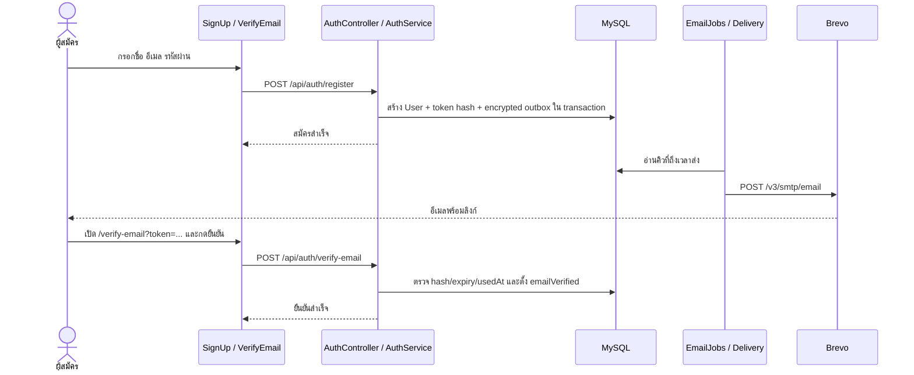
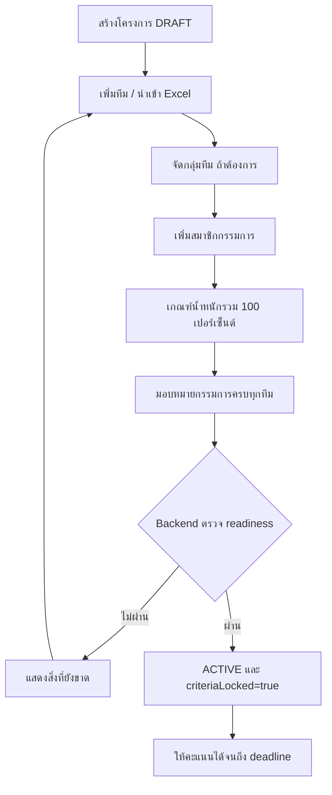
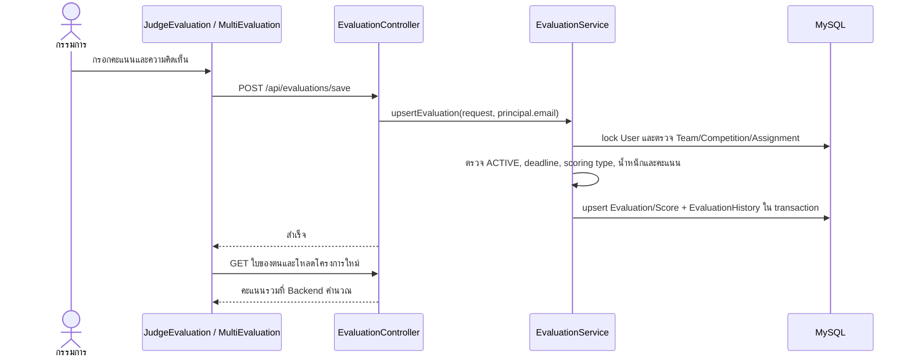

# การทำงานร่วมกัน การติดตั้ง และการทดสอบ

[กลับสารบัญ](README.md)

## 1. สมัครและยืนยันอีเมล



AuthService ตรวจอีเมล ชื่อ และรหัสผ่าน แล้วใช้ BCrypt ก่อนบันทึก ค่า `isSystemAdmin` ของผู้สมัครใหม่เป็น false เสมอ ถ้าเปิด verification บัญชีใหม่ต้องยืนยันก่อน Login กรณียังไม่ยืนยันจะตอบ 403 พร้อม code EMAIL_NOT_VERIFIED แล้ว Frontend พาไปหน้าขอลิงก์ยืนยัน

Verification token อายุ 1 ชั่วโมง ขอใหม่มี cooldown 60 วินาที และ invalidate token เดิม การเปิดลิงก์ไม่ได้ยืนยันอัตโนมัติ ต้องกดปุ่มใน VerifyEmail เพื่อ POST token ไป Backend raw token อยู่ในลิงก์ ส่วนตาราง token เก็บ hash และ outbox ที่รอส่งเก็บ payload แบบเข้ารหัส

`vercel.json` rewrite เส้นทางเข้า index.html สำคัญมาก: เปิดจากอีเมลเป็นการเรียก server โดยตรง ถ้าไม่มี SPA fallback จะได้ 404 แม้การนำทางภายใน React ใช้ได้ ไม่มีการใช้ GET verify token เพื่อเปลี่ยนสถานะบัญชี

## 2. Login และการโหลดข้อมูล

1. Login ส่ง email/password → AuthService ตรวจ BCrypt, ACTIVE และ verification
2. Backend ออก JWT มี subject, ver, issuedAt และ expiry ค่าเริ่มต้น 1,440 นาที
3. AuthContext เก็บ token ที่ `ce_token` ใน localStorage แล้ว GET `/auth/me`
4. `normalizeUser` แปลง role ADMIN จาก auth เป็น SYSTEM_ADMIN ใน UI
5. `loadWorkspace` ดึง `/competitions` แล้ว `loadProject` ทุกโครงการ พร้อม `/notifications`; AuthContext ดึง `/users` สำหรับ directory
6. loadProject เรียก GET ข้อมูลโครงการ ทีม เกณฑ์ กลุ่ม assignments และ evaluations; เพิ่ม members เมื่อเป็นผู้ดูแล ส่วนกรรมการใช้ข้อมูลสมาชิกของตนเป็น fallback
7. หน้าแสดงผลอ่าน cache กลางผ่าน Store ขณะที่ revision ของ AuthContext ใช้ทำให้ consumer ที่ memoized อ่านค่าใหม่

หนึ่งรอบ `loadProject` สำหรับผู้ดูแลปกติเป็น 7 HTTP requests ส่วนกรรมการเป็น 6 requests เพราะไม่เรียก members จึงไม่ควรตีความ polling 15 วินาทีว่าเป็นเพียง 4 requests ต่อนาทีเสมอ การโหลด Workspace มี requests เพิ่มตามจำนวนโครงการ

JWT filter ตรวจฐานข้อมูลทุก request ว่าบัญชียัง ACTIVE, verification ผ่าน และ ver ตรง tokenVersion การ Logout ฝั่ง browser ลบ token/cache; การ Reset Password เพิ่ม tokenVersion เพื่อให้ JWT เก่าใช้ต่อไม่ได้

## 3. เตรียมโครงการจนเปิดรับคะแนน



ลำดับในภาพเป็น workflow ที่เข้าใจง่าย ไม่ใช่กฎว่าต้องทำทุก API ตามลำดับนี้ตายตัว โครงการถูกสร้างเป็น DRAFT ก่อน แล้วเตรียมข้อมูลจนพร้อมเปิด ไม่ต้องให้ทุกทีมมีจำนวนกรรมการเท่ากัน แต่ทุกทีมต้องมีกรรมการอย่างน้อยหนึ่งคนที่มีบทบาท JUDGE/ADMIN_JUDGE ส่วนกลุ่มไม่ใช่เงื่อนไขบังคับของ readiness

การเชิญต้องใช้บัญชีที่สมัครไว้แล้ว และคำเชิญเป็น Notification ในเว็บ ไม่ส่งอีเมล ถ้าเจ้าของเพิ่มตนเองเป็นกรรมการ จะปรับสมาชิก ADMIN เป็น ADMIN_JUDGE โดยไม่เสียสิทธิ์เดิม การถอดกรรมการที่เป็น ADMIN_JUDGE จะเหลือ ADMIN

เปิด ACTIVE สำเร็จแล้วเกณฑ์ ทีม กลุ่ม สมาชิกและ assignments ถูกล็อกที่ Backend ด้วย row lock เดียวกันกับการเปิดรับคะแนน จึงป้องกันทั้งฟอร์มเก่าและ request พร้อมกัน การพักเป็น DRAFT ไม่ปลดล็อก เปลี่ยนชื่อ/รายละเอียด/category หลังล็อกไม่ได้ แต่เปลี่ยน deadline ได้และเก็บ actor/ค่าเดิม/ค่าใหม่ใน deadline_history

## 4. นำเข้าทีมจาก Excel

1. TeamImportModal รับ File → readTeamWorkbook ตรวจ extension `.xlsx` และไบต์ ZIP ไม่ยอมรับแค่เปลี่ยนนามสกุลไฟล์เก่า
2. ExcelJS อ่าน workbook ใน browser โดยข้าม node รูปแบบเอกสารที่ไม่จำเป็น
3. ผู้ใช้เลือกชีตและมี/ไม่มี header; parseTeamWorksheet จับ header ไทย/อังกฤษ หรือใช้ตำแหน่งคอลัมน์
4. อ่านข้อความ rich text ผลสูตร cached และ hyperlink; ตรวจชื่อ ความยาวและ URL http/https
5. แสดง preview พร้อม error ต่อแถว แล้วส่งแถวที่ผ่านให้ ProjectTeams.handleImportTeams
6. Frontend ตัดชื่อซ้ำ แล้วเรียก POST `/teams` ทีละทีม แต่ละครั้งโหลดโครงการกลับ

ไม่ส่งไฟล์ทั้งไฟล์ขึ้น Backend และไม่มี batch import transaction หากนำเข้าไปแล้วบางทีมก่อนพบ error ทีมที่สำเร็จยังอยู่ ต้องดูจำนวนสำเร็จและแถวที่เหลือก่อน retry การตัดชื่อซ้ำจาก UI ไม่ใช่ข้อรับรอง unique teamName ที่ DB

## 5. บันทึกและแก้คะแนน



Draft อนุญาตยังไม่ให้คะแนนบางเกณฑ์ และเก็บเฉพาะ comment บางเกณฑ์ได้ แต่ SUBMITTED ต้องครบทุกเกณฑ์ ค่า 0 และ PASS_FAIL=0 เป็นคะแนนที่ตอบแล้ว ไม่ใช่ค่าว่าง ห้ามส่ง criterionId จากโครงการอื่น เกณฑ์ซ้ำ หรือค่าที่อยู่นอกช่วง

Backend ใช้ใบเดิมของคู่กรรมการ/ทีม ไม่เพิ่มใบซ้ำเมื่อแก้ไข ถ้าเคยส่งแล้วส่ง request เป็น DRAFT ก็ยังคง SUBMITTED เพื่อไม่ถอนคะแนนที่เผยแพร่แล้ว การแก้ก่อน deadline เปลี่ยนคะแนนที่ใช้จัดอันดับ และเวลาส่งอัปเดตตามการบันทึกนั้น เมื่อถึง deadline จะบันทึกหรือส่งไม่ได้แม้เปิดหน้าค้างไว้

ประวัติเก็บ snapshot ก่อน/หลังกับชื่อกรรมการและชื่อทีมในขณะนั้น ถ้าข้อมูลไม่เปลี่ยนจะไม่เพิ่มประวัติซ้ำ การบันทึก audit ล้มเหลวทำให้การเขียนคะแนน rollback ด้วย ผู้ดูแลที่ไม่ใช่เจ้าของไม่เห็น DRAFT_SAVED หรือ before snapshot ที่เป็น DRAFT

## 6. สูตรคะแนนและอันดับ

```text
normalized_i = score_i / maxScore_i × 100
PASS_FAIL: 1 → 100, 0 → 0
evaluation_total = Σ(normalized_i × weight_i / Σweight)
team_average = Σ(evaluation_total ของใบ SUBMITTED ที่นับได้) / จำนวนใบนั้น
```

น้ำหนักต้องรวม 100 ก่อนประเมิน Backend ใช้ BigDecimal และ HALF_UP ปัดคะแนนรวมใบประเมิน 1 ตำแหน่ง Frontend มี Scoring.js สำหรับแสดงตัวอย่าง และ Leaderboard เฉลี่ย totalScore ของใบที่เซิร์ฟเวอร์ให้สิทธิ์ดู ไม่ได้คำนวณจาก UUID

ตัวอย่าง: สองเกณฑ์เต็ม 10 น้ำหนัก 60/40 กรรมการ A ให้ 8/6 ได้ 72; กรรมการ B ให้ 4/10 ได้ 64 เมื่อ A ส่งแต่ B ยัง draft ค่าเฉลี่ยทีมเป็น 72 เมื่อ B ส่งแล้วเป็น (72+64)/2 = 68

อันดับปัจจุบันเรียงค่าเฉลี่ยมากไปน้อยแล้วกำหนด rank=index+1 **คะแนนเท่ากันยังได้อันดับต่างกัน** ไม่มีกฎ tie-break ธุรกิจที่ระบุชัด และทีมที่คะแนนยังไม่ครบยังปรากฏพร้อมสถานะรอผล จึงควรแยกผลระหว่างแข่งขันกับผลสุดท้ายก่อนประกาศรางวัล CSV สร้างใน browser ไม่มี endpoint export แยก

## 7. ส่งหลายทีมพร้อมกัน

getBatchSubmissionCandidates ตรวจทุกทีมที่ได้รับมอบหมายและทุกเกณฑ์ แม้ถูกซ่อนด้วย filter จัดกลุ่ม ready/incomplete/submitted และถ่าย snapshot ก่อนยืนยัน Frontend ส่ง `/evaluations/submit-batch` request เดียว

BatchEvaluationService ไม่มี outer transaction ครอบทั้งชุด และเรียก EvaluationService.submitUnsubmitted แบบ REQUIRES_NEW ต่อทีม ดังนั้นทีมหนึ่งล้มเหลวไม่ย้อนทีมที่สำเร็จ ทีมที่ส่งไปแล้วได้ ALREADY_SUBMITTED และไม่ถูกเขียนทับด้วย batch นี้ ผู้ใช้ต้องอ่านผลรายทีม ไม่ตัดสินจาก HTTP 200 ของ request หลักเพียงอย่างเดียว

## 8. ระบบอีเมลและแจ้งเตือน

| ประเภท | ในเว็บ | อีเมล | เงื่อนไข |
|---|---|---|---|
| สมัคร/ยืนยัน | หน้าผลสมัคร/verify | ส่งลิงก์ Verify | บัญชีใหม่ที่ verification-enabled |
| ลืมรหัสผ่าน | หน้าขอลิงก์ | ส่ง Reset | บัญชี ACTIVE; คำตอบไม่เปิดเผยการมีบัญชี |
| เชิญเข้าโครงการ | PROJECT_INVITATION | ไม่ส่ง | เพิ่มสมาชิกคนอื่นสำเร็จ |
| เตือนประเมินด้วยปุ่ม | REMINDER | เข้าคิวส่ง | admin, ACTIVE, มี deadline, งานค้าง, เว้นหนึ่งชั่วโมง |
| เตือนประเมินอัตโนมัติ | REMINDER | เข้าคิวส่ง | deadline เหลือไม่เกิน 24 ชั่วโมง มีงานค้าง และ dedupe ผ่าน |

EmailJobs.dispatch ค่าเริ่มต้นรอ 15 วินาทีหลังรอบก่อนเสร็จ เลือก outbox ถึงเวลาไม่เกิน 20 รายการต่อรอบ EmailJobs.remind ตรวจทุก 60 วินาที การเตือน AUTO ใช้ key โครงการ+ผู้ใช้ ปัจจุบันการเปลี่ยน deadline ไม่สร้าง key รอบใหม่ให้คนที่เคยเตือน AUTO ไปแล้ว

EmailDeliveryService ตรวจความเกี่ยวข้องอีกครั้งก่อนส่ง เช่นยืนยันแล้ว, reset token ใช้แล้ว, deadline ผ่าน, บัญชีถูกระงับ, กรรมการส่งครบแล้ว → ยกเลิกคิวที่ไม่เกี่ยวข้อง Retry สำหรับความผิดพลาดชั่วคราวสูงสุดรวม 6 attempts โดย delay 1/2/4/8/16 นาทีระหว่างรอบที่ล้มเหลว และมี cap 60 นาทีในสูตร

ACCEPTED คือ Brevo รับคำขอพร้อม messageId ไม่ใช่หลักฐาน delivered/read ยังไม่มี webhook bounce/open/delivery tracking การส่งอีเมลภายนอกกับ commit DB ไม่ใช่ distributed transaction จึงไม่รับรอง exactly-once ในกรณี provider รับแล้วแต่แอป crash ก่อนบันทึกผล

## 9. การอัปเดตข้อมูลอัตโนมัติ

| ส่วน | ช่วงปกติหลังคำขอเดิมเสร็จ |
|---|---|
| Leaderboard | 15 วินาที |
| EvaluationMonitoring | 15 วินาที |
| JudgeScoreMonitoring | 15 วินาที |
| Workspace | 30 วินาที |
| Navbar Notifications | 30 วินาที |
| UserManagement / System Admin | 30 วินาที |

ทุกส่วนใช้ useVisiblePolling → startVisiblePolling เริ่มดึงเมื่อเข้า หยุด timer เมื่อ document hidden ดึงเมื่อกลับมา ป้องกัน request ซ้อน **ภายใน controller เดียว** manual refresh ร่วม Promise กับรอบที่กำลังรอ และเลื่อนรอบถัดไปเมื่อผิดพลาดสูงสุด 120 วินาที สำเร็จแล้วกลับช่วงปกติ System Admin พัก polling ระหว่างเปลี่ยนสิทธิ์/ลบบัญชีเพื่อไม่ให้ผลเก่าทับการแก้

เมื่อออกหน้า stop ทำให้ผลที่รออยู่ไม่ setState ต่อและไม่วาง timer ใหม่ แต่ไม่ได้ Abort HTTP request ที่ส่งออกไปแล้ว ไม่มีการรวม/deduplicate ข้ามทุก controller เช่น Workspace กับ Navbar ยังเรียก notifications ได้คนละรอบ การเปิดหลายแท็บหรือหลายผู้ใช้ยังเพิ่มภาระตามจำนวน session

หน้ากรอกคะแนนและแก้โครงสร้างไม่เพิ่ม polling ทั้งโครงการเพื่อรักษา input ที่กำลังพิมพ์ แต่ Navbar ยังดึงแจ้งเตือนแยก การครบ deadline ใช้ useDeadline ตั้ง timeout เพื่อ render ใหม่ ไม่ใช่ fetch loop

## 10. System Admin และสัญญาณควรตรวจสอบ

System Admin ดู `/admin/users` คู่กับ `/admin/monitoring` ซึ่งแสดงโครงการทั้งหมด กิจกรรมล่าสุด 100 รายการ และสัญญาณจาก:

- สร้างถึง burst limit: ค่าเริ่มต้น 3 โครงการใน 10 นาที
- สร้างถึง daily limit: ค่าเริ่มต้น 10 โครงการใน 24 ชั่วโมง
- มี CREATE_DENIED ใน 24 ชั่วโมงอย่างน้อยหนึ่งครั้ง
- จำนวนโครงการคงอยู่ถึง total limit: ค่าเริ่มต้น 30

quota ใช้ค่าสูงกว่าระหว่างจำนวน project rows กับประวัติ PROJECT_CREATED ในช่วงเวลา การลบโครงการจึงไม่ทำให้จำนวนที่เคยสร้างในช่วงนั้นหายไปง่าย ๆ และล็อกแถวบัญชีเพื่อคุม request พร้อมกัน สัญญาณเหล่านี้เป็นการเฝ้าดูกฎการใช้งาน ไม่ได้ตรวจ IP/device fingerprint, ยืนยันตัวตนบุคคล หรือทำนายการทุจริต

บล็อกสร้างโครงการต่างจากระงับบัญชี: อย่างแรกยังดู/ประเมินงานเดิมได้ตามสิทธิ์ อย่างหลัง JWT filter ปฏิเสธการเข้าระบบ ไม่อนุญาตระงับ/ลบ System Admin ผ่านหน้าจอปัจจุบัน การยกระดับบัญชีเป็น System Admin ต้องทำโดยผู้ดูแลฐาน ไม่ใช่ checkbox ในแบบสมัคร

## 11. การตั้งค่าและ Deploy

| ชั้น | ค่าหลัก |
|---|---|
| Vercel | root ที่ repository Frontend, build `npm run build`, output `dist`, VITE_API_URL ที่ลงท้าย `/api`, SPA rewrite |
| Render | Root Directory `backend`, Dockerfile `./Dockerfile`, build context `.`, ไม่ใช้ npm/yarn start |
| Aiven | สร้าง database ก่อน เช่น ce_system_db; ใช้ host/port จริงของบริการและ TLS |
| Backend env | SPRING_PROFILES_ACTIVE, DB_URL, DB_USERNAME, DB_PASSWORD, DB_DDL_AUTO, FRONTEND_URL, JWT_SECRET, MAIL_ENCRYPTION_KEY, BREVO_API_KEY, BREVO_SENDER_EMAIL |

FRONTEND_URL ใช้ทั้ง CORS และลิงก์อีเมล ไม่ต้องต่อ `/api` ส่วน VITE_API_URL ต้องต่อ `/api` ค่า VITE เป็น build-time ต้อง build/redeploy Frontend ใหม่หลังเปลี่ยน คีย์ฐาน/Brevo/JWT ต้องไม่ตั้งเป็น VITE_* และห้าม commit ลง Git

JWT secret ต้องไม่น้อยกว่า 32 UTF-8 bytes ตาม JwtUtil ส่วน mail encryption secret ถูก derive เป็น AES key ใน MailPayloadCipher ไม่พบการตรวจความยาวขั้นต่ำแบบ JwtUtil ใน constructor นั้น จึงควรสร้างค่าสุ่มที่แข็งแรงแยกกันและคงค่าเดิมเพื่ออ่าน outbox ที่ยังไม่ส่งได้

Dockerfile ใช้ Maven build ข้าม tests แล้วคัดลอก JAR ไป Java 17 runtime รัน UID 10001 แบบ non-root และใช้ prod profile แอปอ่าน PORT ของ hosting Production ใช้ ddl-auto validate หลัง schema พร้อม Local properties จริงถูก ignore และไม่อยู่ใน image

ตามการใช้งานที่ตั้งไว้ Render free อาจพักเมื่อไม่มีคนเรียกและ Aiven ต้องแยก Free plan ออกจาก trial เครดิต เงื่อนไขผู้ให้บริการเปลี่ยนได้ ต้องตรวจ dashboard ก่อนพรีเซ็นต์ รายงานนี้อธิบายผลต่อระบบ: **เมื่อ Backend หยุด scheduler จะไม่ส่งอีเมลหรือสร้าง reminder ตามเวลา** ไม่ควรใช้การเปิดแท็บค้างเป็นกลไก uptime ที่รับรองได้

### ลำดับตรวจหลัง Deploy

1. Backend startup สำเร็จและเชื่อมฐานถูกตัว ไม่ใช่ localhost
2. เปิด `/verify-email` และ `/reset-password` โดยตรงไม่ 404
3. สมัคร → รับเมล → ยืนยัน → Login และรีเซ็ตรหัสผ่านด้วยลิงก์ใหม่
4. เจ้าของสร้างงาน เชิญกรรมการจากบัญชีอื่น และเห็นข้อมูลตาม polling
5. บันทึก draft → ส่ง → แก้ก่อน deadline → ปฏิเสธหลัง deadline
6. ตรวจล็อกทุก write endpoint ไม่เพียงปุ่ม UI
7. ตรวจคะแนนร่วมสองกรรมการ ประวัติ อันดับและ CSV
8. สำรองข้อมูลและทดสอบกู้คืนก่อนวันนำเสนอ

## 12. สถานะการทดสอบ

Frontend ชุดทดสอบล่าสุดในการพัฒนา 46 รายการผ่าน พร้อม lint/build ผ่าน หลังเพิ่ม System Admin polling รายงานนี้เป็นการอ่าน source และสร้างเอกสาร ไม่ได้แอบอ้างว่ารันทดสอบ Production ใหม่ทั้งหมด

Backend มีผล Maven Surefire ในเครื่องรวม 47 tests, failures=0, errors=0 จากการตรวจรอบก่อนหน้า ใช้ H2 และ mock บริการอีเมล ไม่เทียบเท่าการตรวจ TLS, performance หรือ schema จริงบน Aiven ทุกกรณี รายการ suite และชื่อ testcase ดู [ภาคผนวกไฟล์และการทดสอบ](FILES_AND_TESTS.md)

คำสั่งตรวจสำหรับผู้พัฒนา:

```powershell
# ที่ root repository
npm test
npm run lint
npm run build

# ที่ backend/
.\mvnw.cmd verify
```

### กรณี user ใช้จริงที่ควรสาธิต

| กรณี | ผลที่คาด |
|---|---|
| เจ้าของ 1 คน กรรมการ 2 คน ใช้คนละ browser profile | ข้อมูลตรงตาม role/assignment และเห็นผลเมื่อ polling สำเร็จ |
| กรรมการ A ส่ง B ยัง draft | ผู้ดูแลเห็นเฉพาะ A; draft/history ของ B ไม่รั่ว |
| B ส่งแล้ว A แก้ก่อน deadline | ค่าเฉลี่ยและประวัติอัปเดต ไม่เพิ่มใบประเมินซ้ำ |
| ส่ง batch มีทีมไม่ครบ/หมดเวลา | แสดงผลรายทีมและไม่ rollback ทีมที่สำเร็จ |
| เปิดรับคะแนนแล้วส่ง request แก้ทีม/เกณฑ์/assignment ด้วยฟอร์มเก่า | Backend ตอบ 409 |
| ขอ Verify/Reset ซ้ำและใช้ลิงก์เก่า | token เก่าไม่ผ่านและระบบคุม cooldown |
| ลืมตั้ง JWT secret หรือสั้นกว่า 32 bytes | Backend ปฏิเสธ startup |
| โครงการถูกบล็อกสร้างหรือเกิน quota | 403 หรือ 429 พร้อมสัญญาณ monitoring |
| ซ่อนแท็บแล้วกลับมา | ไม่วาง polling ขณะซ่อนและดึงใหม่เมื่อกลับมา |
| เน็ตช้ากว่ารอบ polling | ไม่เรียกซ้อนใน controller เดียวและไม่หายหน้ารายการเดิม |

## 13. ข้อจำกัดที่ควรบอกตรง ๆ และงานต่อยอด

- ยังไม่มีผล load test/latency budget หรือขนาดผู้ใช้พร้อมกันที่รับรองได้
- Workspace โหลดรายละเอียดทุกโครงการ ทำให้ request/query โตตามจำนวนโครงการ; ควรมี summary endpoint, pagination และ lazy-load เมื่อขยายระบบ
- System monitoring รวมทุกบัญชีและนับ quota หลายครั้ง อาจเกิด query จำนวนมากเมื่อผู้ใช้โต ควรวัดและใช้ aggregate query/pagination
- ยังไม่มี server-side endpoint จัดอันดับ, นโยบายคะแนนเสมอหรือ finalize ผลการแข่งขันแบบ snapshot
- ยังไม่มี optimistic locking/version สำหรับแก้ใบเดียวกันจากหลายแท็บของกรรมการคนเดียว แม้มี row lock จัดลำดับการเขียนแล้ว จึงอาจเป็น last successful write
- Assignment replacement เป็นหลาย request อาจสำเร็จบางส่วน ไม่ atomic ทั้งรายการ ต่างจาก bulk move ทีมที่เป็น transaction เดียว
- ยังไม่มี API upload Excel batch, refresh token, Google/GitHub Login ของแอป, WebSocket/SSE, Brevo delivery webhook หรือเครื่องมือ backup/restore อัตโนมัติใน source
- ไม่พบ Flyway/Liquibase, global login/register rate limiter, CAPTCHA หรือ IP/device detection; quota สร้างโครงการและ cooldown อีเมลไม่ใช่การป้องกันทุก abuse
- บัญชีที่ Login แล้วเรียก `/users` ได้ directory ของบัญชี ACTIVE ทั้งหมด ควรทบทวนการเปิดเผยอีเมลหากใช้นอกโครงการสาธิต
- อีเมลแจ้งเตือนตามเวลาอาศัย Backend ที่ทำงานอยู่ และควรทดสอบเมื่อเปลี่ยนแผน hosting
- ไม่ควรใช้ schema update อัตโนมัติแทน migration/backup ที่ตรวจสอบได้สำหรับข้อมูลจริงระยะยาว

สิ่งเหล่านี้เป็นขอบเขตของ implementation ไม่ใช่ผลสรุปว่าระบบล้มเหลว และรายงานนี้ไม่ได้เปลี่ยน business rule หรือแก้ feature เหล่านี้เพิ่มเอง
