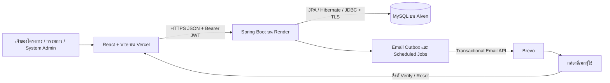

# รายงานโครงสร้างและการทำงานของ MultiRole

วันที่ตรวจโค้ด: 30 ตุลาคม 2026 — โครงการระบบจัดการการแข่งขันและประเมินคะแนนหลายบทบาท

## ขอบเขตและวิธีอ่าน

รายงานนี้อ้างอิง source code ใน repository ปัจจุบัน ไม่ใช้ ER Diagram รุ่นแรกแทน schema ล่าสุด ไม่อ่านค่ารหัสผ่านหรือ API key จากไฟล์ส่วนตัว และไม่ได้แก้ไขข้อมูลในฐาน Production รายการไฟล์/ฟังก์ชันและ API มีลิงก์กลับไปยัง source เพื่อเปิดตรวจสอบต่อได้

| เอกสาร | เนื้อหา |
|---|---|
| [Frontend](FRONTEND.md) | ทุกไฟล์ใน `src/`, หน้าจอ, component, hook, store และฟังก์ชันที่มีชื่อ |
| [Backend](BACKEND.md) | Controller, Service, Security, DTO, Repository และหน้าที่แต่ละ method |
| [API](API.md) | HTTP method/path, สิทธิ์, request/response, จุดเรียกจาก Frontend และ Brevo |
| [Database](DATABASE.md) | ทุก Entity, field, ความสัมพันธ์, constraint และส่วนที่ต่างจาก ER เดิม |
| [การทำงานร่วมกันและการทดสอบ](FLOWS_AND_TESTS.md) | ลำดับตั้งแต่สมัครจนจัดอันดับ, polling, การ Deploy, การทดสอบและข้อจำกัด |
| [ไฟล์ประกอบและ Test Cases](FILES_AND_TESTS.md) | config/build/deploy, รายชื่อ testcase และผล Backend tests ที่มีอยู่ในเครื่อง |

ขนาด source ที่ตรวจ: Frontend 77 ไฟล์และ named functions 307 จุด, Backend main 86 ไฟล์ (รวม model/config), Entity 18 ตาราง และ REST endpoints 54 รายการ มี [API reference แบบ JSON](API_REFERENCE.json) และ [รายการ source พร้อม SHA-256](SOURCE_MANIFEST.json) สำหรับเทียบเวอร์ชันภายหลัง

ภาคฟังก์ชันแสดงฟังก์ชันที่มีชื่อใน source รวม helper และ handler ภายใน component ฟังก์ชันนิรนามใน `map/filter`, JSX event และ hook effects อธิบายตามหน้าที่ของไฟล์ ไม่แยกเป็นชื่อฟังก์ชันที่ไม่มีอยู่จริง Getter/Setter ที่ Lombok สร้างและ method ที่สืบทอดจาก JpaRepository อธิบายรวม ไม่ใช่โค้ดที่เขียนซ้ำในทุกไฟล์

## 1. ระบบนี้แก้ปัญหาอะไร

MultiRole รวมการเตรียมการแข่งขัน การเพิ่มทีม/กลุ่ม เชิญกรรมการ มอบหมายทีม กำหนดเกณฑ์ถ่วงน้ำหนัก ให้คะแนน เก็บฉบับร่าง ส่งหลายทีม ติดตามผล และสรุปอันดับไว้ในระบบเดียว ผู้จัดไม่ต้องรวมคะแนนหลายกรรมการด้วยตนเอง และกรรมการเห็นงานที่ได้รับมอบหมายของตัวเอง

ตาราง `evaluation` เก็บใบประเมินของกรรมการต่อทีม ส่วน `score` เก็บคะแนนและความคิดเห็นรายเกณฑ์ ไม่เก็บคะแนนทุกคนรวมกันลงช่องเดียว จึงติดตามความคืบหน้าและประวัติแก้คะแนนได้

## 2. สถาปัตยกรรม

Frontend ไม่เชื่อม MySQL โดยตรง ความลับของฐานข้อมูลและ Brevo อยู่ที่ Backend ส่วนค่าที่ Frontend ใช้คือ `VITE_API_URL` ซึ่งเป็น URL สาธารณะ การทำงานที่เปลี่ยนข้อมูลต้องผ่านการตรวจสิทธิ์ของ Backend แม้ผู้ใช้จะแก้ request เอง

| ชั้น | เทคโนโลยีตามโค้ด | หน้าที่ |
|---|---|---|
| หน้าจอ | React 19, React Router 7 | แสดงผล รับข้อมูล และเลือกเส้นทางตามบทบาท |
| สร้าง Frontend | Vite 8, Tailwind CSS 4 | build assets และจัดรูปแบบ |
| HTTP Client | Axios | แนบ JWT, timeout และแปลงข้อความผิดพลาด |
| Excel | ExcelJS | อ่าน `.xlsx` และสร้าง template ใน browser |
| Backend | Java 17, Spring Boot 4.1.1 | REST API, business rules และ scheduler |
| สิทธิ์ | Spring Security, JWT, BCrypt | ตรวจ token, สถานะบัญชี และรหัสผ่าน |
| Persistence | Spring Data JPA, Hibernate, MySQL Connector/J | ติดต่อฐานข้อมูลและจัด transaction |
| อีเมล | Java HttpClient → Brevo | ส่งข้อความที่อยู่ในคิว |
| Tests | Node test runner; Spring Boot tests + H2 | ตรวจตรรกะ Frontend และ API/transaction Backend |

เลขรุ่น Frontend อ้างอิงช่วงเวอร์ชันใน `package.json`; เวอร์ชันติดตั้งแน่นอนดู `package-lock.json` ไม่ใช่การรับรองว่าใช้ library รุ่นล่าสุดจากผู้ผลิต

## 3. บทบาทและขอบเขตสิทธิ์

| บทบาท | เก็บ/แสดงที่ไหน | ความสามารถหลัก |
|---|---|---|
| ผู้ใช้ทั่วไป | บัญชีที่ไม่ใช่ System Admin | สร้างโครงการภายใต้ quota และเข้าร่วมโครงการที่เป็นสมาชิก |
| Project Admin | `competition_user.role = ADMIN` | เตรียมข้อมูล เปิด/พัก/ปิดรับคะแนน ดูผลและจัดอันดับ |
| Judge | `competition_user.role = JUDGE` | ประเมินเฉพาะทีมที่ถูกมอบหมาย ดูคะแนน/ประวัติของตน |
| Admin + Judge | `competition_user.role = ADMIN_JUDGE` | คงสิทธิ์จัดการโครงการและเพิ่มหน้าที่กรรมการในโครงการเดียวกัน |
| System Admin | `users.is_system_admin = true` | ติดตามทั้งระบบ เปลี่ยนสถานะบัญชี ลบบัญชี และบล็อกการสร้างโครงการ |

ข้อควรแยก: ค่า role `ADMIN` ใน AuthResponse หมายถึง System Admin และถูก Frontend แปลงเป็น `SYSTEM_ADMIN` ขณะที่ `ADMIN` ในสมาชิกโครงการหมายถึง Project Admin เป็นข้อมูลคนละระดับกัน

System Admin ไม่ถูกสร้างอัตโนมัติเมื่อ Deploy ฐานใหม่ ต้องสมัครและยืนยันบัญชี แล้วเพิ่ม flag ของบัญชีเป้าหมายผ่านผู้ดูแลฐานข้อมูล ไม่มี public API สำหรับผู้ใช้ยกระดับตนเอง

## 4. กลุ่มความสามารถและเจ้าของไฟล์

| ความสามารถ | หน้าจอ/ตัวประสาน Frontend | Backend หลัก |
|---|---|---|
| สมัคร/Login | Login, SignUp, AuthContext, client | AuthController, AuthService, JwtUtil |
| ยืนยันบัญชี/Reset | VerifyEmail, ResetPassword | EmailVerificationService, PasswordResetService |
| Workspace | WorkSpace, ProjectStore, workspace | CompetitionController |
| ภาพรวม/สถานะ/Deadline | ProjectDashboard, DeadlineHistory | CompetitionController, ProjectReadinessService |
| ทีม/Excel/กลุ่ม | ProjectTeams, TeamImportModal, TeamGroupManagement | TeamController, TeamGroupController |
| กรรมการ/มอบหมาย | ProjectJudge, JudgeTeamAssignments | CompetitionUserController, JudgeAssignmentController |
| เกณฑ์/Rubric | CriteriaManagement, Rubric, Scoring | CriteriaController, CriteriaPolicy |
| ให้คะแนนทีมเดียว/หลายทีม | JudgeEvaluation, JudgeMultiEvaluation | EvaluationController, EvaluationService, BatchEvaluationService |
| คะแนนที่ฉันให้ | JudgeScoreMonitoring | EvaluationController.listMine/history |
| ติดตามผล/อันดับ | EvaluationMonitoring, ProjectLeaderboard | EvaluationController.listByCompetition |
| ประวัติแก้คะแนน | EvaluationHistory | EvaluationHistoryService |
| แจ้งเตือน | Navbar, NotificationStore | NotificationController, EvaluationReminderService |
| ดูแลระบบ | UserManagement, SystemMonitoringOverview | UserController, SystemMonitoringController, ProjectCreationPolicy |

## 5. กฎสำคัญที่ควรใช้ตอบในการพรีเซ็นต์

1. **คะแนนรวมคำนวณที่ Backend** ไม่เชื่อคะแนนรวมที่ browser ส่งมา Frontend คำนวณเพื่อแสดงตัวอย่างและจัดอันดับจากผลที่ได้รับ
2. **Draft เป็นส่วนตัวของกรรมการ** ผู้ดูแลดูผลที่ส่งแล้วและไม่เห็น draft ของผู้อื่น รวมถึง snapshot ฉบับร่างในประวัติ
3. **คะแนนที่ส่งแล้วแก้ได้ก่อน deadline** และยังเป็น SUBMITTED อยู่ ไม่ถอยกลับเป็น draft
4. **เปิดรับคะแนนแล้วล็อกโครงสร้าง** เกณฑ์ ทีม กลุ่ม สมาชิก และการมอบหมายไม่เปิดแก้ แม้พักกลับ Draft; deadline เปลี่ยนได้พร้อมประวัติ
5. **การส่งหลายทีมแยก transaction ต่อทีม** ผลจึงสำเร็จบางทีมได้ ไม่รับรอง all-or-nothing ทั้งชุด
6. **Realtime ปัจจุบันคือ polling** หน้าเป้าหมายเรียก REST API ตามช่วงเวลา ไม่ใช่ server push/WebSocket
7. **Brevo ตอบรับไม่เท่ากับเข้ากล่องสำเร็จ** สถานะ ACCEPTED ยืนยันเพียงผู้ให้บริการรับคำขอ ไม่ใช่ delivered/read
8. **บัญชีควรตรวจสอบเป็นกฎตาม quota** ไม่ใช่ระบบ AI ตรวจคนร้าย และสัญญาณไม่ใช่ข้อยืนยันการทุจริต

## 6. สถานะการใช้งานและความถูกต้องของรายงาน

Topology ที่ใช้ในการ Deploy ของโครงการนี้คือ Vercel → Render → Aiven และ Brevo ตามการตั้งค่าใน session การตรวจรายงานไม่ได้เข้าไปอ่าน dashboard ลับหรือยืนยันว่า Production มี source ล่าสุดทุกไฟล์ ต้องเทียบ commit ของบริการกับ snapshot ใน [manifest](SOURCE_MANIFEST.json) อีกครั้ง

สิ่งที่ตั้งใจไม่รวม: `node_modules`, `dist`, `backend/target`, `.git`, ไฟล์ cache, local properties ที่มีความลับ, credentials, ไฟล์ใน repo Backend เก่าที่ไม่ได้เป็น source หลัก และ ER รุ่นเก่าในฐานะข้อมูลจริงของ Production
